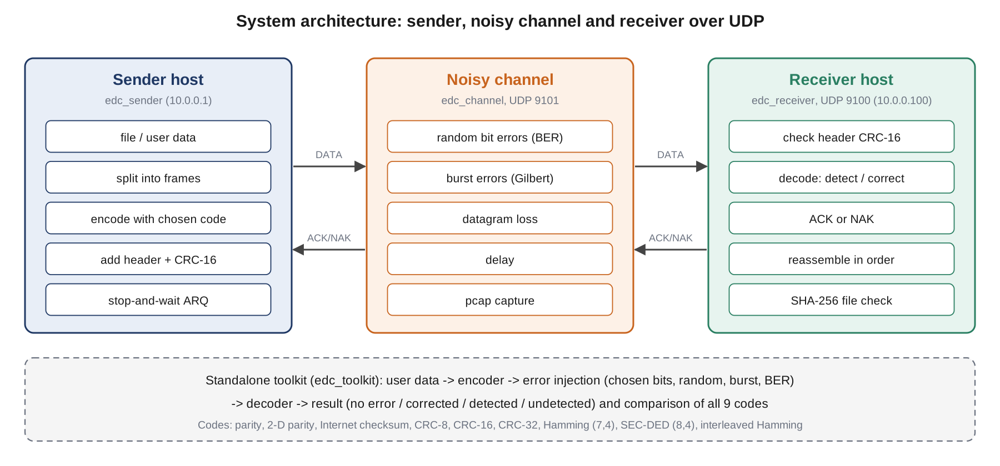
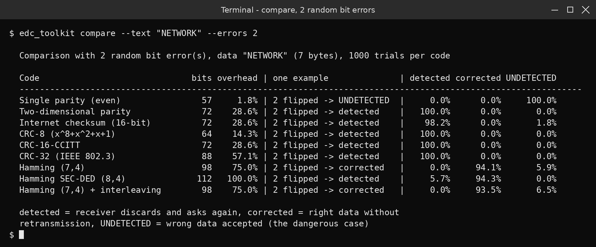
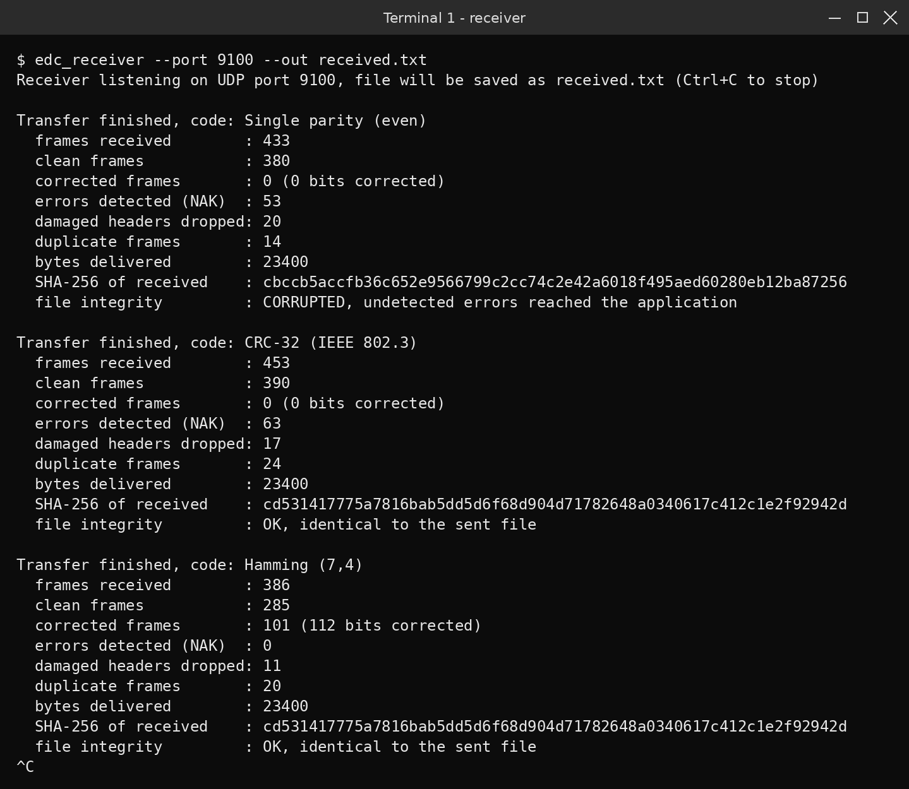
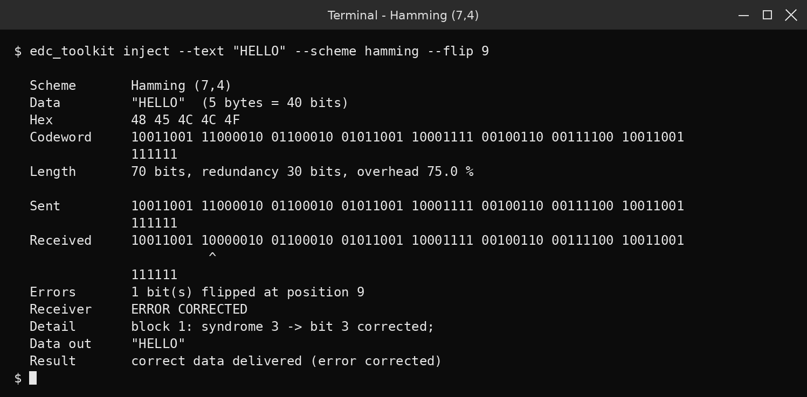
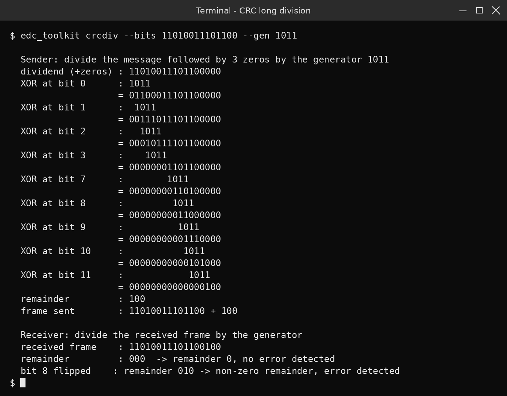

# Network Error Detection and Correction Toolkit

Computer Networks Laboratory (CSE20110) mini project:
*"Allow users to enter data, introduce errors and compare parity, checksum, CRC and
Hamming-code performance."*

Written in **C++17** with only the standard library and the operating system socket API
(Winsock 2 on Windows, BSD sockets on Linux/macOS). No external libraries.



## Screenshots

| Compare all codes | File transfer: receiver |
|---|---|
|  |  |

| Hamming correction | CRC long division |
|---|---|
|  |  |

## What it contains

| Program | Purpose |
|---|---|
| `edc_toolkit` | interactive tool: enter data, choose a code, see the codeword, introduce errors (chosen bits, random bits, bursts, bit error rate), see whether the receiver detects or corrects them, compare all codes, CRC long division step by step |
| `edc_sender` | sends a file over UDP in frames protected by the chosen code, stop-and-wait ARQ (retransmit after NAK or timeout) |
| `edc_channel` | noisy channel between sender and receiver: random bit errors (BER), burst errors (Gilbert-Elliott), datagram loss, delay, pcap capture |
| `edc_receiver` | decodes every frame, corrects what the code can correct, sends ACK or NAK, checks the whole file with SHA-256 |
| `edc_tests` | 24 test cases under normal and failure conditions |
| `edc_bench` | performance experiments B1 to B6 (CSV files and SVG charts) |

Codes implemented (`--scheme` names in brackets):

| Code | Detects | Corrects | Overhead (64-byte frame) |
|---|---|---|---|
| Single parity, even (`parity`) | any odd number of bit errors | - | 1 bit |
| Two-dimensional parity (`parity2d`) | all 1, 2, 3-bit errors (most larger) | 1 bit | 14.3 % |
| Internet checksum 16-bit (`checksum`) | all single-bit errors, most others | - | 16 bits |
| CRC-8, x^8+x^2+x+1 (`crc8`) | all bursts <= 8 bits | - | 8 bits |
| CRC-16-CCITT (`crc16`) | all bursts <= 16 bits, all double errors | - | 16 bits |
| CRC-32 IEEE 802.3 (`crc32`) | all bursts <= 32 bits, all double errors | - | 32 bits |
| Hamming (7,4) (`hamming`) | - | 1 bit per 7-bit block | 75 % |
| Hamming SEC-DED (8,4) (`secded`) | 2 bits per block | 1 bit per block | 100 % |
| Hamming (7,4) + block interleaving (`hamming-il`) | - | bursts up to the number of blocks | 75 % |

## Building

Windows (MinGW-w64 g++ in PATH): `build.bat`  
Linux / macOS: `./build.sh`  
Any system with CMake: `cmake -B build && cmake --build build`

The programs are built into `bin/` (this folder is not stored in the repository; build first).

## Using the toolkit

```
bin\edc_toolkit                                    interactive menu
bin\edc_toolkit encode  --text "HELLO" --scheme crc32
bin\edc_toolkit inject  --text "HELLO" --scheme hamming --flip 9
bin\edc_toolkit inject  --text "HELLO" --scheme parity --flip 3,20
bin\edc_toolkit compare --text "NETWORK" --errors 2
bin\edc_toolkit compare --text "NETWORK" --burst 12
bin\edc_toolkit compare --text "NETWORK" --ber 0.01
bin\edc_toolkit crcdiv  --bits 11010011101100 --gen 1011
```

Data can be text, `hex:48 45 4C` or `bin:01001000`.

## File transfer over a noisy network

Three terminals:

```
bin\edc_receiver --port 9100 --out received.txt
bin\edc_channel  --listen 9101 --server 127.0.0.1:9100 --ber 3e-4 --delay 1 --pcap noisy.pcap
bin\edc_sender   sample_files\message.txt --port 9101 --scheme crc32 --frame 64
```

Try `--scheme parity` (the receiver reports the file as CORRUPTED: double errors passed the
parity check), `--scheme crc32` (errors detected, frames resent, file identical) and
`--scheme hamming` (single errors corrected at the receiver without retransmission).
`--burst 0.0005,0.1` on the channel gives burst errors instead of random ones.
On two lab PCs use `--host <IP>` on the sender and `--server <IP>:9100` on the channel.

## Frame format (UDP payload)

| Bytes | Field |
|---|---|
| 0-1 | magic 0x4544 ("ED") |
| 2 | version (1) |
| 3 | type: 1 DATA, 2 ACK, 3 NAK, 4 FIN, 5 FIN-ACK |
| 4 | code (scheme id 1 to 11) |
| 5 | flags (FIN-ACK: 1 file identical, 2 file corrupted) |
| 6-9 | sequence number |
| 10-11 | data length in bytes |
| 12-13 | codeword length in bits |
| 14-15 | CRC-16-CCITT of bytes 0-13 (header check) |
| 16- | codeword (data protected by the chosen code), packed into bytes |

The FIN frame carries the file size and the SHA-256 of the file, protected by CRC-32.

## Tests and experiments

```
bin\edc_tests                 24 test cases (about 40 s), results\test_results.csv
bin\edc_bench                 all experiments (about 5 minutes)
bin\edc_bench --only B1,B2    selected experiments
```

| Experiment | What is measured |
|---|---|
| B1 | detected / corrected / undetected frames for 1 to 8 random bit errors |
| B2 | detection of burst errors of length 1 to 64 |
| B3 | frame outcomes for bit error rates 1e-4 to 3e-2 |
| B4 | overhead and encode / decode speed |
| B5 | file transfer over the UDP channel: goodput, retransmissions, file integrity vs BER |
| B6 | goodput vs frame size at BER 1e-3 |

## Wireshark

Copy `wireshark/edc_frame.lua` to the Wireshark personal Lua plugins folder and open
`results/noisy_capture.pcap` or `docs/live_capture.pcapng`, or capture live with
`udp port 9100 or udp port 9101`. Display filter `edcf`; `edcf.hcrc_ok == 0` shows frames
whose header was damaged by the channel.

## Limitations

* Stop-and-wait ARQ: simple and easy to observe, but slow on long links (one frame per RTT).
* The bit-level implementation favours clarity over speed (tens of MB/s).
* Errors are injected by the emulated channel; real Ethernet and Wi-Fi already drop frames
  with a bad link-layer CRC, so this is an emulation of a noisy link.
